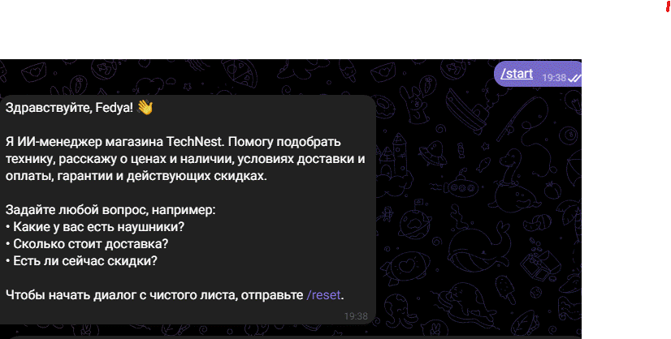

# 🤖 AI-Manager Telegram Bot Terminal




## 📖 About

**AI-Manager Telegram Bot Terminal** is an advanced, interactive Telegram bot that automates customer support and sales consultation for the fictional electronics store **TechNest**. It answers questions about products, prices, delivery, payment, warranty, and promotions strictly from an editable knowledge base, remembers the context of each conversation, and can operate either with a large language model (OpenAI / Anthropic) or in a fully autonomous **MOCK mode** that requires no API keys at all.

## ✨ Key Features

- **Two operating modes**
  - **AI mode:** connects to OpenAI or Anthropic through a single `AI_PROVIDER` switch.
  - **MOCK mode:** a lightweight keyword-based engine that picks the right fragments from the knowledge base and phrases them like a polite sales manager. It activates automatically when no API key is set.
- **Customizable knowledge base:** all store data (catalog, prices, delivery, payment, returns, promotions, FAQ, tone of voice) lives in a plain-text `knowledge_base.txt`. Edit the file, restart the bot, and the assistant speaks about your business. The AI is instructed to answer strictly from this file.
- **Asynchronous engine on aiogram 3.x:** fully non-blocking handlers, a "typing…" indicator while the answer is being prepared, and non-blocking database access.
- **Resilient by design:**
  - Uses long polling, so there is no public URL, SSL certificate, or webhook setup to configure or get blocked.
  - If the AI provider fails (network error, rate limit, invalid key), the bot logs the error and gracefully falls back to a MOCK reply instead of crashing.
  - A failed database write never prevents the customer from receiving an answer.
- **Conversation memory:** dialogue history is stored per user in SQLite via `aiosqlite`. The last 6 messages (configurable through `HISTORY_LIMIT`) are passed to the model as context, so the conversation flows naturally.
- **Clean, modular architecture:** configuration, storage, AI logic, and Telegram handlers each live in their own module.

## 🛠 Tech Stack

| Component | Technology |
|-----------|------------|
| Language | Python 3.11+ |
| Bot framework | aiogram 3.x |
| Storage | SQLite / aiosqlite |
| AI providers | OpenAI API, Anthropic API (optional) |
| Configuration | python-dotenv |

## 🚀 Quick Start

The bot works **out of the box**: the only thing you need is a Telegram bot token. Without an AI API key it starts in MOCK mode automatically.

**1. Clone the repository**

```bash
git clone https://github.com/<Urbanexxx>/ai-sales-manager-bot.git
cd ai-sales-manager-bot
```

**2. Create a virtual environment and install dependencies**

```bash
python -m venv venv
source venv/bin/activate        # Windows: venv\Scripts\activate
pip install -r requirements.txt
```

**3. Create your `.env` file**

Copy the template (`.env.example`) to `.env`:

```bash
cp .env.example .env            # Windows: copy .env.example .env
```

**4. Add your Telegram bot token**

Get a token from [@BotFather](https://t.me/BotFather) and paste it into `.env`:

```env
TELEGRAM_BOT_TOKEN=your_token_here
```

**5. Run the bot**

```bash
python main.py
```

Open your bot in Telegram, send `/start`, and ask anything about TechNest products, delivery, or discounts.

### Enabling AI mode (optional)

To switch from MOCK mode to a real language model, set the provider and its API key in `.env`:

```env
AI_PROVIDER=openai              # or: anthropic
OPENAI_API_KEY=your_key_here    # or: ANTHROPIC_API_KEY=your_key_here
```

Restart the bot. The startup log shows which mode is active.

### Bot commands

| Command | Description |
|---------|-------------|
| `/start` | Greeting and a short introduction to what the bot can do |
| `/reset` | Clears the conversation history for the current user |

## 🗂 Project Structure

```
ai-sales-manager-bot/
├── main.py              # Entry point: bot, dispatcher, startup hooks, polling
├── config.py            # Settings and secrets loaded from .env
├── database.py          # SQLite storage for conversation history
├── ai_integration.py    # System prompt, OpenAI/Anthropic requests, MOCK mode
├── handlers.py          # /start, /reset and text message handlers
├── knowledge_base.txt   # Store data: catalog, delivery, payment, FAQ, tone
├── requirements.txt     # Python dependencies
└── .env.example         # Environment variables template
```

## 🧩 Customizing the Store

Open `knowledge_base.txt` and replace the TechNest sample data with your own products, prices, delivery terms, and communication rules. Lines starting with `#` are treated as comments and are never sent to the AI.
